# cpa-auto-router

> [CLIProxyAPI (CPA)](https://github.com/router-for-me/CLIProxyAPI) 原生插件：虚拟模型 `auto` —— 自动按请求难度与能力需求，把每次请求路由到 CPA 中你自己已有的模型。

**English summary:** A native CLIProxyAPI plugin that exposes virtual models `auto` / `auto-fast` / `auto-max`. Each new user turn is classified once by a model of your choice; the router scores your CPA model pool on 8 capability dimensions plus a difficulty tier, picks the best model and thinking level (per-model levels ported from oh-my-pi), is image-aware, escalates automatically on unhappy follow-ups or upstream failures, and ships a web panel with a flow view, session drilldown and token statistics. The panel theme follows CPA (light/dark). Requires CLIProxyAPI >= 8.0.47 (plugin ABI 1). MIT licensed.

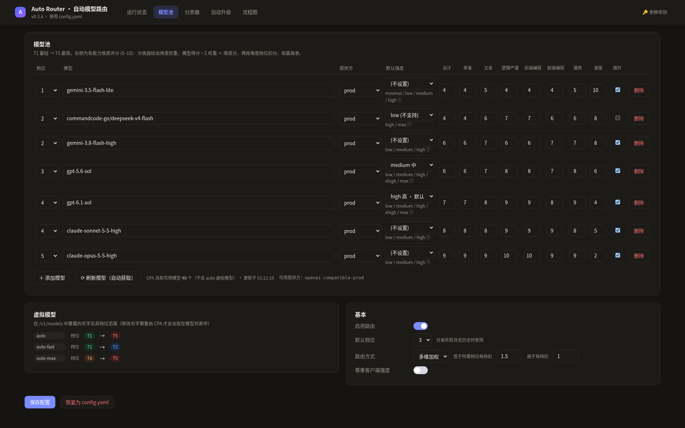

## 简介

客户端只需把模型名写成 `auto`。插件对每个**新的用户轮次**调用一次分类器，得到：

- **难度档位** T1（最轻）→ T5（最强）；
- **8 个能力维度权重**：设计、审美、文本、逻辑严谨、后端编程、前端编程、通用、速度；
- 是否包含图片。

然后对模型池中每个模型计算 `Σ 权重 × 维度分`，并按档位差扣分，选出得分最高者，附带合适的思考强度（`model(effort)`）。同一轮的工具调用循环保持同一模型（sticky），不会重复分类。

## 功能

- 🧭 **自动分类路由**：分类器可以是 CPA 里的任意模型。
- 📊 **8 维能力评分 + 档位**：每个池模型都可以在面板里逐项打分。
- 🧠 **按模型的思考强度**：思考档位表移植自 [oh-my-pi](https://github.com/can1357/oh-my-pi)，并与 CPA 实际接受的值取交集；升级时沿该模型自己的档位阶梯上调。
- 🖼️ **图片感知**：请求含图片时，自动排除不支持图片的模型。
- ⬆️ **自动升级**：用户不满意的追问、上游失败 / 拒答、可选的 review 标记 → 档位 +1（顶档时提升强度），最多 2 步，连续 3 轮正常后回落，空闲 30 分钟重置。
- 🔀 **流程图**：入口 → 分类器 → 档位 → 升级 → 模型 的桑基式视图，可点击会话查看每一轮路径；档位按**实际调用模型的档位**计数，**正在输出的请求**以闪烁节点 + 橙/黄色流动虚线标出（v0.3.6）。
- 📌 **粘性路由（缓存优先，可选，默认关闭）**：会话当前模型仍可用且得分与最高分相差 ≤ 阈值（默认 0.8 分）时沿用当前模型，减少来回切换、提高提示词缓存命中率（v0.3.6）。
- 🔢 **Token 统计**：输入 / 缓存 / 写入 / 输出，按会话与决策汇总。
- 🎨 **主题跟随 CPA**：浅色 / 深色自动切换。
- 🧩 **虚拟模型**：`auto`、`auto-fast`（T1–T2）、`auto-max`（T4–T5），出现在 `/v1/models`。

## 截图

| | |
|---|---|
| 模型池（浅色）<br>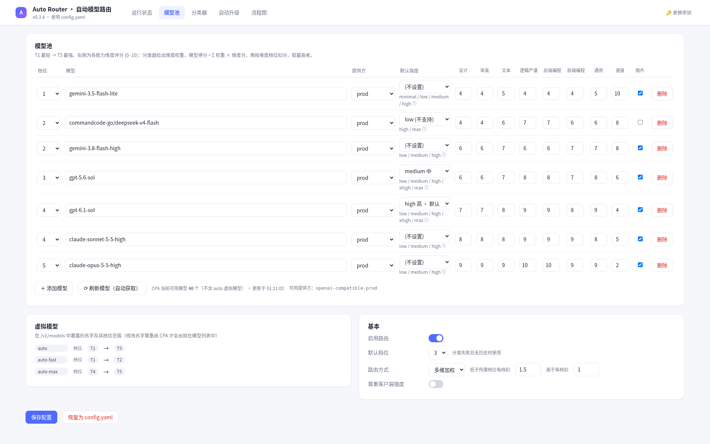 | 流程图（深色）<br>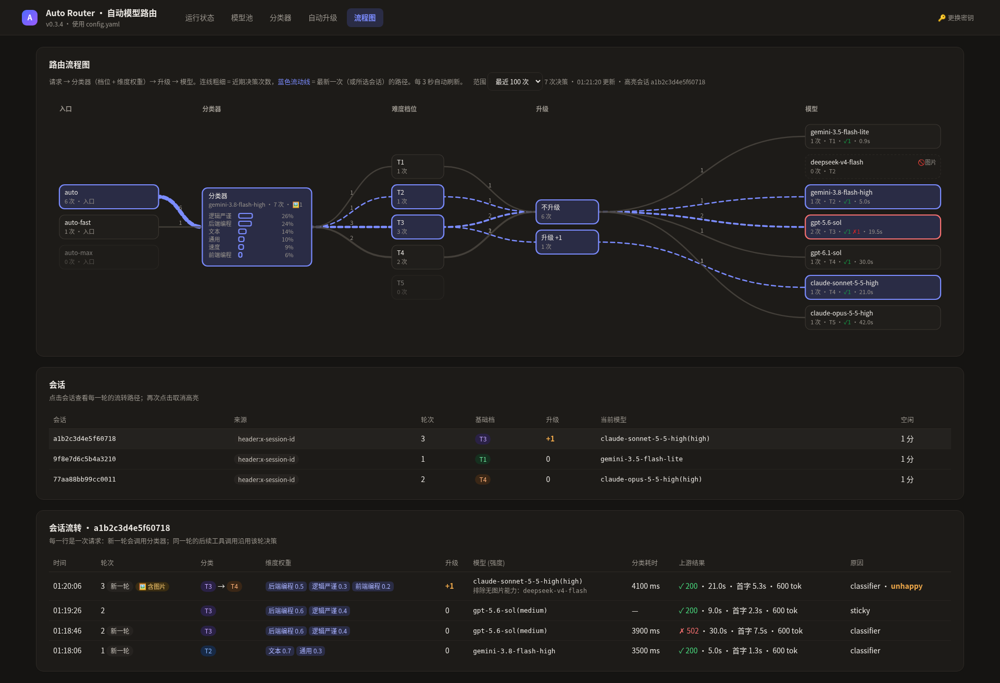 |
| 流程图（浅色）<br>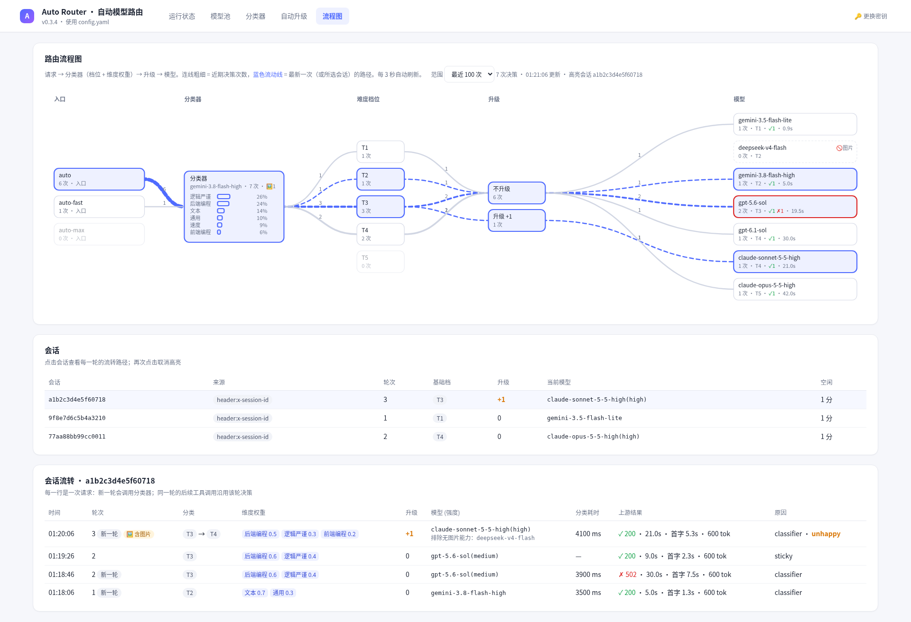 | 会话下钻 + Token<br>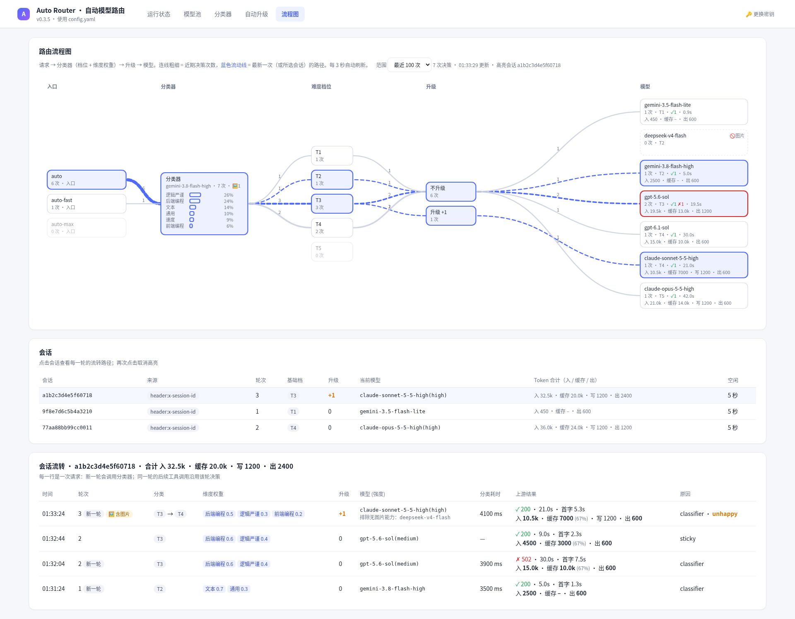 |
| 运行状态 / 决策 / Token<br>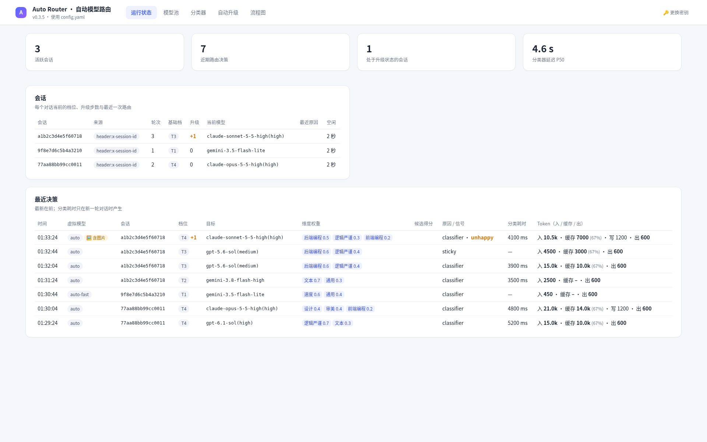 | 管理密码弹窗<br>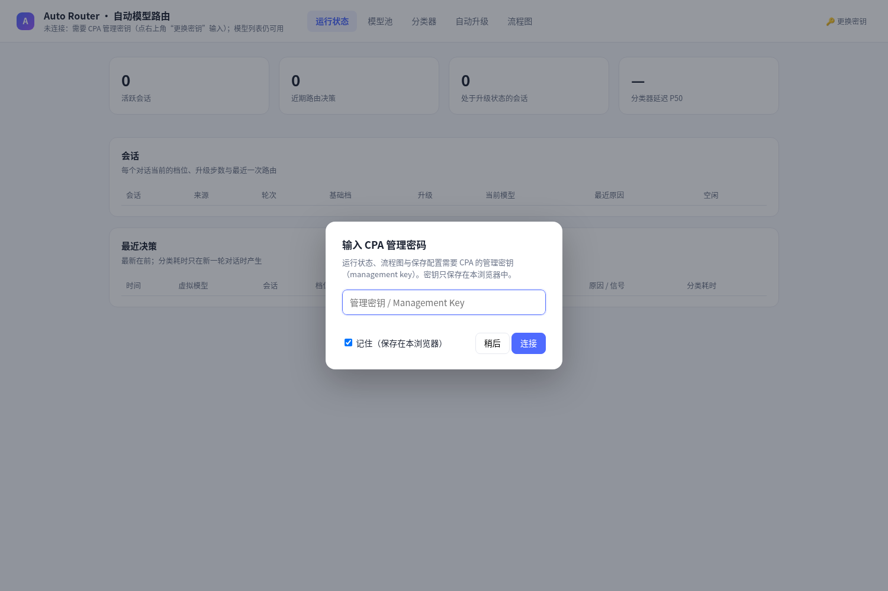 |
| 模型选择器<br>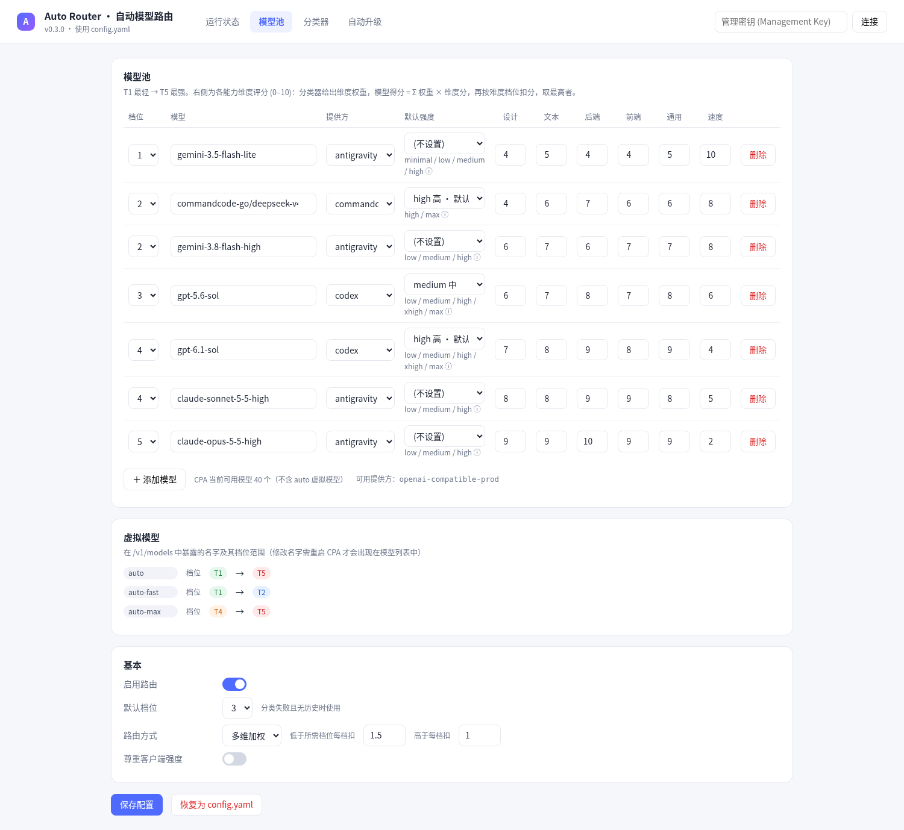 | 思考强度档位<br>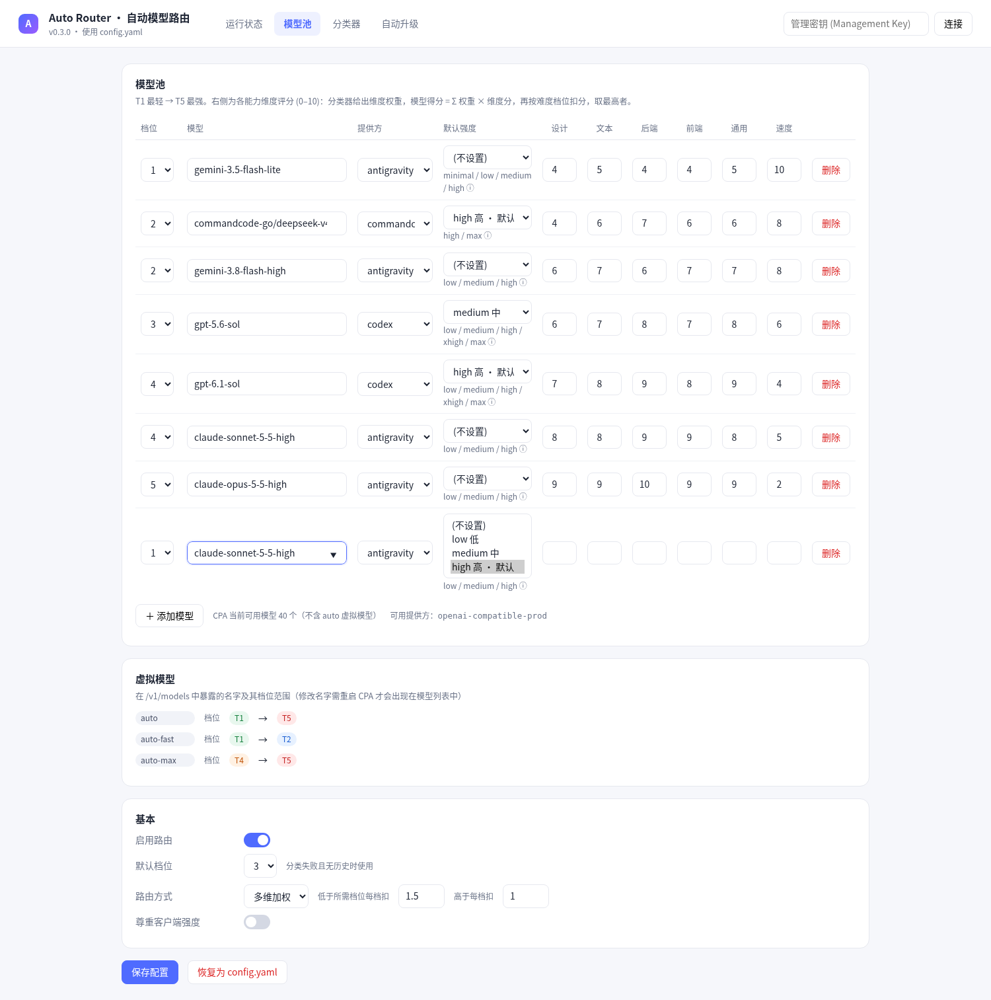 |
| 8 维能力评分<br>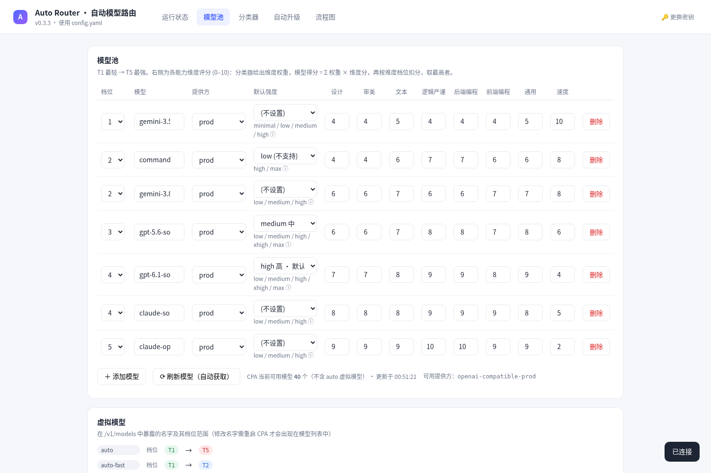 | 正在运行的模型（深色）<br>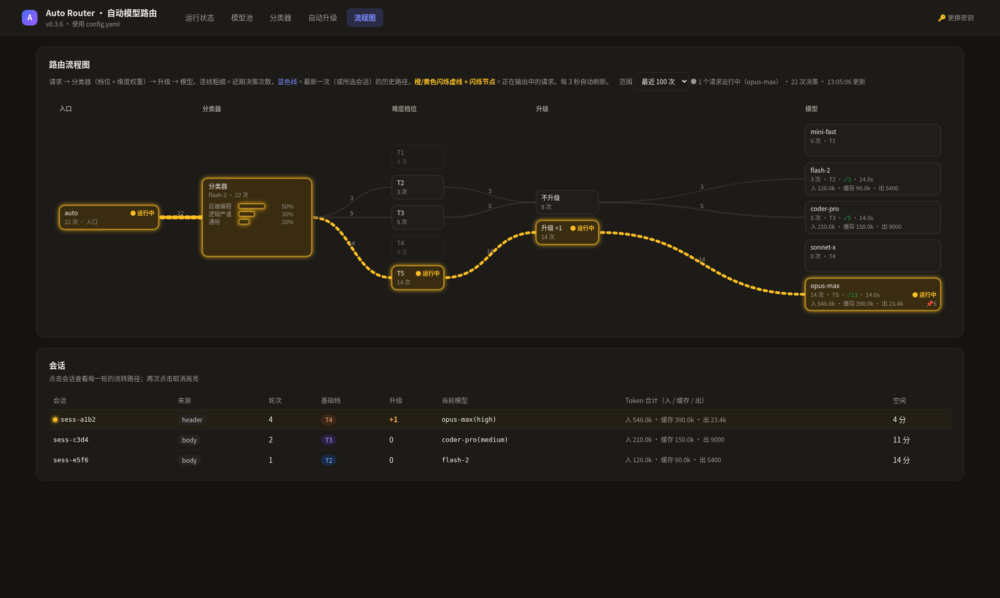 |
| 粘性路由开关<br>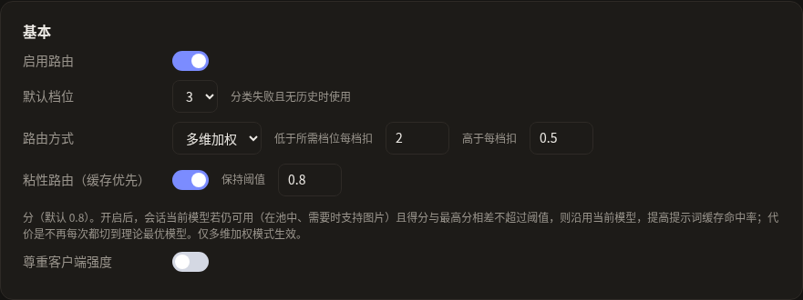 | 故障转移设置<br>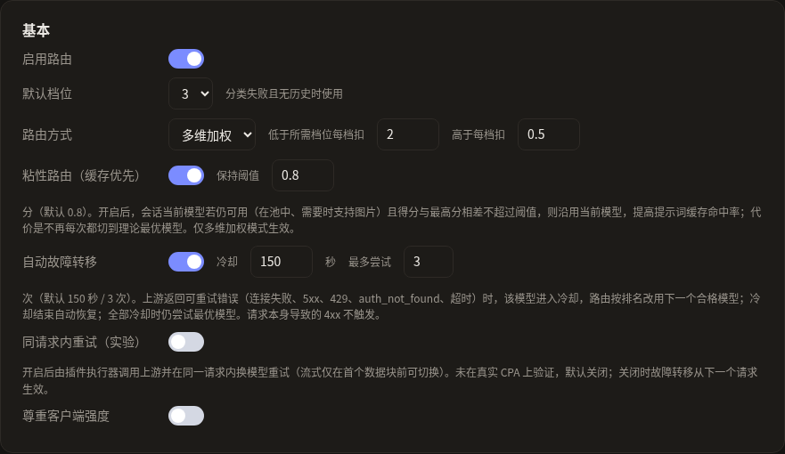 |
| 故障转移跳转 / 冷却（深色）<br>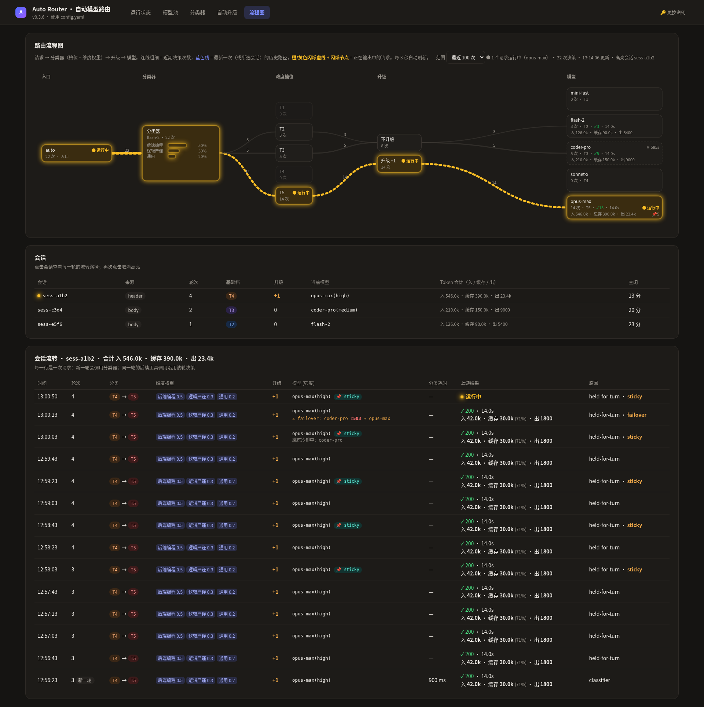 | |

## 环境要求

- CLIProxyAPI **>= 8.0.47**（插件 ABI 1）
- 从源码构建：Go（见 `go.mod`），Windows DLL 交叉编译需要 [zig](https://ziglang.org/)

## 安装

1. 从 Releases 下载 `cpa-auto-router.dll`（Windows）或 `cpa-auto-router.so`（Linux），或自行构建。
2. 复制到 CPA 目录下的 `plugins/`。
3. 在 CPA 的 `config.yaml` 中 `plugins.configs` 下加入 `cpa-auto-router` 配置段（参考 [`config.example.yaml`](config.example.yaml)）。
4. 重启 CPA。`GET /v1/models` 中应出现 `auto`、`auto-fast`、`auto-max`。

## 配置参考

```yaml
cpa-auto-router:
  enabled: true
  virtual_models: ["auto", {name: "auto-fast", max_tier: 2}, {name: "auto-max", min_tier: 4}]
  classifier:
    kind: model            # model = 任意 CPA 模型；jev = 直连 OpenAI 兼容接口（规划中）
    model: "gemini-3.8-flash-high"
    effort: ""
    timeout_ms: 6000
  default_tier: 3          # 分类失败且无历史时使用
  respect_client_effort: false
  pool:
    - {tier: 1, model: "gemini-3.5-flash-lite", provider: "my-provider"}
    - {tier: 3, model: "gpt-5.6-sol", provider: "my-provider", effort: "medium"}
    - {tier: 5, model: "claude-opus-5-5-high", provider: "my-provider"}
  routing: {mode: weighted, under_penalty: 1.5, over_penalty: 1.0, sticky: false, sticky_margin: 0.8,
             failover: true, failover_cooldown_seconds: 150, failover_max_attempts: 3, failover_inline: false}
  escalation: {enabled: true, on_unhappy: true, on_failure: true, max_steps: 2, decay_after_turns: 3, reset_idle_minutes: 30}
  state_file: "plugins/cpa-auto-router.state.json"
```

| 键 | 说明 |
|---|---|
| `enabled` | 总开关 |
| `virtual_models` | 暴露的虚拟模型名，可用 `min_tier` / `max_tier` 限定档位范围（改名需重启 CPA） |
| `classifier.kind` / `model` / `effort` / `timeout_ms` | 分类器设置 |
| `default_tier` | 分类失败时的默认档位 |
| `respect_client_effort` | 是否尊重客户端传入的思考强度 |
| `pool[]` | `tier`、`model`、`provider`、`effort`、`efforts`、`scores`（8 维）、`image` |
| `routing` | 路由方式（多维加权）及档位扣分系数；`sticky` / `sticky_margin` 见下方“粘性路由”；`failover*` 见“自动故障转移” |
| `escalation` | 自动升级：`on_unhappy`、`on_failure`、`max_steps`、`decay_after_turns`、`reset_idle_minutes`、`review{enabled, markers}` |
| `state_file` | 面板保存的配置，优先于 yaml；面板“恢复为 config.yaml”会删除它 |

## 面板使用

打开 `http://<CPA 地址>/v0/resource/plugins/cpa-auto-router/panel`。首次会弹出**管理密码**对话框，输入 CPA 的 management key（可选择仅保存在本浏览器）。面板包含：运行状态、模型池、分类器、自动升级、流程图。

相关接口（需 management key）：`/v0/management/auto-router/{state,config,decisions,models,classifier-test}`。

## 粘性路由（缓存优先）

自动路由每次都按得分选最优模型，相邻几轮的维度权重稍有波动就可能在两个分数相近的模型之间来回切换，导致上游提示词缓存失效、缓存命中率下降。开启 **粘性路由** 后：

- 若会话已有当前模型，且该模型**仍然可用**（仍在模型池 / 虚拟模型档位范围内；请求含图片时支持图片输入），
- 且它的最终得分与本次最高分之差 **≤ `sticky_margin`**（默认 **0.8** 分，略低于默认的“高一档扣 1.0 分”，因此不会为了缓存而接受整整一档的错配），
- 则沿用当前模型，不切换。

例外：当前模型低于本次所需档位、而最高分模型档位更高时（例如自动升级），照常切换，升级不会被粘性挡住。仅在“多维加权”模式生效；“仅按档位”模式本身就是确定性的。

面板：模型池 → 基本 → “粘性路由（缓存优先）”开关与“保持阈值”。被沿用的决策在运行状态、会话流转中显示 `📌 sticky` 徽标（悬停可见原本的最高分模型），流程图模型节点显示 📌 次数，日志信号中带 `sticky`。

权衡：开启后缓存命中率更高、成本与首字延迟通常更低，但不再每一轮都切到理论最优的模型，因此默认关闭，由用户自行选择。

## 自动故障转移

默认开启。上游返回**可重试**错误时——连接失败、5xx、429、`auth_not_found`/503、超时（以及 401/403/404 这类凭证/渠道问题）——该模型进入冷却（默认 **150 秒**），路由按当前排名（多维加权分数或档位距离）改用下一个合格模型，同样遵守图片能力与虚拟模型的档位范围。冷却结束自动恢复；若所有合格模型都在冷却，仍尝试最优的那个。请求本身导致的 4xx（如 400/413/422）不会触发；含图片请求的 400 仍走原有的图片兜底逻辑。处理为故障转移的失败不再触发“失败升档”。

| 配置 | 默认 | 说明 |
|---|---|---|
| `routing.failover` | `true` | 总开关 |
| `routing.failover_cooldown_seconds` | `150` | 失败模型冷却时长 |
| `routing.failover_max_attempts` | `3` | 同请求内重试模式下每个请求最多尝试次数（上限 5） |
| `routing.failover_inline` | `false` | 实验：同一请求内重试 |

面板：模型池 → 基本 设置；模型池行和流程图模型节点显示 `❄ 冷却` 倒计时；运行状态与会话流转中显示 `⚠ failover: A ✗503 → B` 跳转记录及“跳过冷却中”的模型。

**限制（请务必了解）**

- CPA 插件 ABI 的 `model.route` 只决定路由目标，插件拿不到该次上游调用的结果，只能事后从用量回调得知失败。因此**默认模式下故障转移从下一个请求开始生效**：失败的那个请求，客户端仍会收到原始错误（多数客户端会自动重试，重试即落到下一个模型）。
- `failover_inline: true` 时，虚拟模型请求被路由到插件自身的执行器，由插件通过 `host.model.execute(_stream)` 指定提供方调用上游，并在同一请求内依次重试候选模型。此模式**未在真实 CPA 上验证**，协议转换/请求头行为可能与直连不同，因此默认关闭。
- 流式请求只能在**首个数据块之前**切换模型；一旦开始向客户端输出，中途失败无法无缝转移。
- 冷却状态只保存在内存中，重启 CPA 后清空。

## 虚拟模型

| 名称 | 档位范围 | 用途 |
|---|---|---|
| `auto` | T1–T5 | 默认 |
| `auto-fast` | T1–T2 | 追求速度 / 低成本 |
| `auto-max` | T4–T5 | 追求质量 |

## 分类器选择

分类器可以是 CPA 中任意可用模型（推荐快速、便宜的 flash 类模型）。可在面板“分类器”页测试。计划支持通过 TypeSafe 调用 Jev 专用分类器。

## 常见问题 / 排错

- **分类器总是失败、退回默认档位**：分类器模型名必须带正确的提供方前缀，例如 `commandcode-go/deepseek-v4-flash`，与 CPA `/v1/models` 中的名称完全一致。
- **返回 `503 auth_not_found`**：池中模型或分类器模型在 CPA 中没有可用凭据，或 `provider` 填错。在面板“模型池”点“刷新模型”检查。
- **`/v1/models` 看不到 `auto`**：确认 CPA 版本 >= 8.0.47、DLL 在 `plugins/` 下且配置段 `enabled: true`，然后重启。
- **面板提示未连接**：点右上角“更换密钥”重新输入 management key。

## 从源码构建

```bash
go test ./... && go vet ./...
./build.sh windows   # dist/cpa-auto-router.dll（需要 zig）
./build.sh linux     # dist/cpa-auto-router.so
```

设计说明见 [docs/DESIGN.md](docs/DESIGN.md)，思考档位数据见 [docs/PROFILES.md](docs/PROFILES.md)。

## 路线图

- [ ] Jev 分类器（经 TypeSafe）
- [ ] 基于历史结果自动调整维度评分
- [ ] 更多升级信号与成本预算
- [ ] 预编译 Release（Windows / Linux / macOS）

## 许可证

[MIT](LICENSE) © 2026 BugCooker-cooking。思考档位表移植自 oh-my-pi（MIT），设计受 magpie 启发，详见 [THIRD_PARTY_NOTICES](THIRD_PARTY_NOTICES)。
